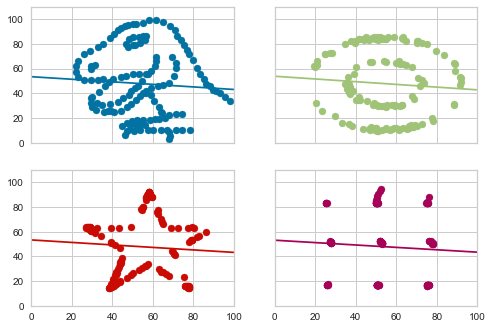

# Yellowbrick-Datasaurus
Exploring Anscombe’s Quartet and the Datasaurus Dozen datasets it inspired through the built-in functions in Yellowbrick Python machine learning visualization library



## Environment
Run the following command in a terminal shell to create a conda virtual environment from the YAML file:

```conda env create --file YBdatasaurus_env.yml```
